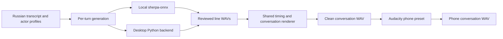

advanced-planning

# Russian phone-call audio: macro plan

Created: 2026-10-09. Status: Russian-dialog implementation complete and ready for
user testing. M2–M4 engineering deliverables are complete. M1 voice/engine selection
and M5 listening/device acceptance remain pending. M6 AMD work is separate and
untested. See [verification](implementation-verification.md).

## Goal and priorities

1. Produce one audio file containing a Russian conversation between two or more recognizably different, consistent voices, with believable turn timing and a phone-call sound.
2. Run the selected large TTS model on the user's AMD GPU when a supported, tested runtime is available. GPU work must not block the first usable recording.

The recommended final workflow is: paste a transcript into Dialog, assign an actor voice to each speaker, generate and review the lines, render/export `conversation-clean.wav`, process a copy in free Audacity, and export `conversation-phone.wav`. Keep the clean master, actor references, transcript, and settings for revisions. A real telephone connection is unnecessary.

## Linked plans

- [Macro progress](plan.macro.steps.md)
- [Russian dialogue and export](plan.russian-dialogue.md), [progress](plan.russian-dialogue.steps.md): stages M1–M5.
- [AMD acceleration](plan.amd-acceleration.md), [progress](plan.amd-acceleration.steps.md): stage M6; its inventory/probe steps can inform M1.

These checklists track implementation outcomes, not the act of writing this plan. All new items start unchecked.

## Implemented workflow

| Area | Current behavior |
| --- | --- |
| Transcript and actors | Shared parser, review/edit/override/exclusion, independent actor settings and managed references |
| Generation | Local targets on both apps; pinned VoxCPM2 reference target injected on desktop; sequential dispatch, selective retry, bounded polling and cancellation |
| Persistence | One app-private saved active project; startup/reload validates owned references, clips and master hashes |
| Rendering | Shared background streaming PCM renderer, mono 48 kHz master, exact pauses, anti-alias resampling, manifests and -1 dBFS peak ceiling |
| Playback/export | Exact master preview/seek, independent library copies; desktop save and Android share |
| Phone copy | Audacity 3.7.7 macro, real export and project reopen verified with identical samples |
| Russian quality | Real CPU two/three-actor samples exist; listener must accept reference identity, pronunciation and phone intelligibility |
| Android engines | Local installed models only; no Russian Piper was introduced without evaluation/licensing approval |
| AMD | Separate acceleration plan remains open |

## Model decision, based on current primary sources

There is no measured winner yet. Prefer demonstrated Russian pronunciation, stable identity, and repairable line generation over parameter count alone.

| Candidate | Verified upstream facts | Planned role |
| --- | --- | --- |
| [VoxCPM2](https://huggingface.co/openbmb/VoxCPM2) | 2B parameters; Russian among 30 languages; voice design/cloning; 48 kHz output; Apache-2.0; upstream estimates about 8 GB VRAM | First candidate, because its backend already exists. Published NVIDIA figures do not establish AMD speed or memory usage |
| [OmniVoice](https://github.com/k2-fsa/OmniVoice), [language list](https://github.com/k2-fsa/OmniVoice/blob/master/docs/languages.md) | Russian language ID `ru`; cloning and voice design; Apache-2.0 code | Existing-backend comparison/fallback. Supply reference transcripts and avoid unnecessary ASR loading |
| [Qwen3-TTS](https://github.com/QwenLM/Qwen3-TTS), [model card](https://huggingface.co/Qwen/Qwen3-TTS-12Hz-1.7B-CustomVoice) | Russian supported; 1.7B/0.6B Base and CustomVoice variants; 1.7B VoiceDesign | Conditional quality challenger. CustomVoice has fixed speakers whose native languages are not Russian; evaluate accent. Base with Russian references is another route |
| [Russian Piper models in sherpa-onnx](https://k2-fsa.github.io/sherpa/onnx/tts/all/Russian/index.html) | Official listings include Denis, Dmitri, Irina, and Ruslan | Optional lightweight CPU fallback and shared-platform validation path; verify each artifact and license before catalog approval |

Evaluation order: VoxCPM2 first, then a small OmniVoice comparison if practical; try Qwen if the existing backends fail the Russian quality/identity gate or a quick comparison warrants it. Integrate only the chosen model. Adding multiple model families and fine-tuning are not prerequisites.

For stable actors, prefer a fixed voice/preset or a clean Russian reference plus exact transcript. If references are unavailable, design synthetic voices once, select the samples, and reuse them as references where the selected engine supports that workflow. Repeating a voice description independently for every line does not guarantee identity. A seed alone is not an identity mechanism.

## AMD findings and their limits

Local read-only inventory found Windows 11 Pro build `26200`, Radeon RX 9070 XT, Radeon 780M iGPU, and about 28.8 GiB usable system RAM. Driver version reported by Windows is `32.0.31041.1004`. Windows' `AdapterRAM` value is not reliable for full VRAM capacity; [AMD specifies 16 GB for the RX 9070 XT](https://www.amd.com/en/products/graphics/desktops/radeon/9000-series/amd-radeon-rx-9070xt.html). Verify actual free memory with the selected runtime.

The current [unified AMD matrix](https://rocm.docs.amd.com/en/latest/compatibility/compatibility-matrix.html) and [versioned installation guide](https://rocm.docs.amd.com/en/docs-10.1.0/install/rocm.html) were served as ROCm 10.1.0 during research. The older Radeon/Ryzen documentation stops at 7.2.1 and explicitly lists RX 9070 XT for [Windows PyTorch](https://rocm.docs.amd.com/projects/radeon-ryzen/en/latest/docs/compatibility/compatibilityrad/windows/windows_compatibility.html) and [WSL](https://rocm.docs.amd.com/projects/radeon-ryzen/en/latest/docs/compatibility/compatibilityrad/wsl/wsl_compatibility.html). Do not mix install commands from different documentation generations.

This establishes a supported AMD path to test; it does not establish that this machine has the required stack or that VoxCPM2's complete pipeline works on it. Prefer official native Windows wheels first for convenience, WSL2/Ubuntu next for dependency compatibility, and native Linux/another backend machine only if needed. Record a complete driver/Python/PyTorch/ROCm/model version tuple when it passes.

## Approach and architecture

Basic/shared work: actor/transcript data, local-model Dialog editing/retry, timing, background rendering, final playback/export controls, and generated-audio persistence belong in `tts_core`/`shared_ui` and must be wired into desktop and Android. Platform storage and save/share adapters retain their existing boundaries.

Extended/desktop work: Python model adapters, reference/style controls exposed only when a desktop capability is injected, backend installation/device diagnostics, and ROCm execution remain outside the shared Basic runtime. Shared interfaces may describe a synthesis target, but shared packages must not import desktop services. Catalog metadata remains canonical; add explicit backend/platform availability rather than pretending a backend has an ONNX installation directory.

External Audacity processing is an intentional completion path. An in-app phone effect is optional follow-up work after the first finished recording; it is not required by these checklists.

## Ordered stages and completion gates

### M1 — Validate Russian voices and choose one engine

Run a bounded real synthesis comparison with short Russian turns and two stable actor profiles. Test pronunciation, `ё`, names, numbers, questions, informal replies, and identity across turns. Establish one workable CPU/local-or-existing-remote path; a quick AMD probe may help but extended GPU debugging waits for M6.

Gate: saved listening samples, a measured quality/runtime report, two distinct repeatable actors, and a selected model/configuration. If no model passes, this gate remains incomplete and integration is limited to reusable infrastructure.

### M2 — Connect actor profiles and the selected backend to Dialog

Extend the existing Dialog flow with independent actor settings, capability-driven backend selection, bounded jobs, per-line retry, and stale-result protection. Keep local models working. Reuse task 19 when VoxCPM2 wins; create Qwen-specific integration work only if Qwen wins.

Gate: the desktop app generates all lines of a two-speaker Russian script through the selected engine, reports failures/cancellation correctly, and preserves actor identity. Shared Basic editing/profile changes are integrated on Android using local targets.

### M3 — Render and export one clean conversation

Compose reviewed line WAVs in transcript order with adjustable pauses, compatible PCM formats, safe level handling, and complete-output validation. Persist a render snapshot/manifest and one final WAV; export on desktop/share on Android. Avoid double-applying speaker volume.

Gate: a single clean WAV contains every included turn once, in order, with configured timing; a changed source/profile invalidates the current render. Cross-platform shared behavior is verified.

### M4 — Create a reusable free phone-effect workflow

Use Audacity to make a copy with a conservative narrowband EQ, mild dynamics treatment, and optional low noise/codec coloration. Start with both voices on the phone channel; a local/remote asymmetry or wideband mobile-call variant can be chosen during listening.

Gate: export `conversation-phone.wav` and save exact repeatable effect settings/instructions. The clean master remains available. No paid service/plugin is required.

### M5 — Accept the finished Russian recording workflow

Complete a representative 2–5 minute two-person call, a short three-person example, a failed-turn repair, and a longer approximately 10-minute render. Listen for words, identity, timing, boundary clicks, clipping, and phone-effect intelligibility. Document the actual steps and generation time.

Gate: priority 1 is achieved, with a playable/exported phone WAV, clean master, reusable actor/project settings, and a repeatable guide. Archive completed priority-1 task records before starting another task; this macro remains active if M6 is still being pursued.

### M6 — Prove and optimize AMD GPU execution

Follow the AMD micro plan to test the selected engine on RX 9070 XT using an official supported environment. Verify actual ROCm execution, quality, memory headroom, repeated jobs, and measured CPU/GPU timing. Keep CPU fallback visible and the app usable when GPU initialization fails.

Gate: a real Russian dialogue is generated on that GPU through the desktop app, with device evidence and a reproducible setup/performance report. If the selected pipeline is incompatible, record the failure and next viable AMD route; GPU work remains unfinished rather than being marked complete.

## Assumptions, scope limits, and risks

- Assumption: offline export matters more than streaming latency; initial deliverable is a mono WAV with sequential turns.
- Assumption: begin with two synthetic adult Russian voices; additional speakers are supported by data/UI, not hard-coded as a two-person special case.
- Assumption: no user voice samples or final transcript have been provided. Use a neutral example script for engineering validation; the real recording uses the user's text when available.
- Assumption: external free software is acceptable, as stated by the user. No cloud subscription or GPU purchase is required by the plan.
- Voice quality and actor distinctness require listening, including after phone filtering; automated metrics cannot certify natural dialogue.
- Backend job concurrency must start at one per loaded model/GPU. The existing four local synthesis workers are not a safe large-model concurrency default.
- Current VoxCPM2 defaults enable optimization; eager/unoptimized operation is the first compatibility baseline. Validate pinned `voxcpm==2.0.3` against real upstream APIs before relying on seed, normalization, or style controls.
- Voice design drift, unsupported Russian normalization, dropped/repeated words, long-turn instability, VRAM exhaustion, and mixed sample rates all need explicit handling.
- Mixed models are allowed through normalization, but one model with multiple actor references is preferred to reduce memory and voice-quality discontinuities.
- Overlap/interruption editing, fine-tuning, live phone calls, an effects editor, additional large-model integrations, and automatic MP3 export are optional later work.
- Unknown redistribution status continues to block bundling; local evaluation is distinct from shipping. Review selected checkpoint/runtime/reference assets when updating `docs/licensing.md`.

## Documentation and task discipline

Implementation must update `flow-index.yaml` and the matching local-synthesis, model-settings, audio-output, voice-cloning, catalog/readiness, lifecycle, and edge-case documents in the same changes. The current domain-brain continues to describe current behavior; this plan does not present future behavior as implemented.

Keep checklists synchronized with verified outcomes. Use the existing task 19 for its backend scope. Archive a task as soon as its own completion criteria are met; do not archive incomplete GPU work merely because priority 1 succeeds. At each Basic milestone, report identical shared behavior, platform-specific adapters, and any unwired platform work explicitly.
